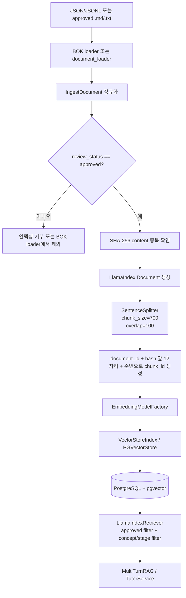

# Leren AI STEP 1 데이터셋 현황 및 구조 분석

## 1. 분석 목적

이 문서는 STEP 1 범위에서 현재 로컬 저장소에 있는 경제·금융 데이터와 데이터 처리 코드를 읽기 전용으로 조사한 결과다. 데이터, DB, 벡터 인덱스, 기존 Python 기능 코드는 변경하지 않았다. 청크 수는 운영 DB에 삽입하지 않고 LlamaIndex `SentenceSplitter`를 메모리에서 실행한 투영값이다.

통계의 의미는 다음과 같이 구분한다.

- **실측값**: 현재 저장소의 JSON/JSONL을 직접 읽어 계산한 값
- **코드 설정값**: `app/core/config.py`와 실제 호출 코드에서 확인한 값
- **문서/리포트 기록값**: `bok_extraction_report.json` 등에 기록되어 있으나 원본 PDF 자체는 로컬에 없는 값
- **미검증**: 외부 API 키, PostgreSQL 접속, 실제 pgvector 인덱스가 없어 실행 확인하지 못한 값

## 2. 분석 대상 및 범위

### 확인한 데이터 위치

현재 `data/`에는 다음 파일이 있다.

| 파일 | 형식 | 역할 |
|---|---|---|
| `data/bok_terms_2026.json` | JSON | 한국은행으로 표기된 원천형 789개 용어 레코드 |
| `data/bok_terms_2026_rag.jsonl` | JSONL | RAG 입력용 789개 레코드 |
| `data/bok_eval_questions.json` | JSON | BOK RAG 평가 케이스 40개 |
| `data/bok_extraction_report.json` | JSON | 추출·검수 집계 리포트 |

다음 디렉터리는 현재 존재하지 않는다. `data/raw/`, `data/processed/`, `data/samples/`.

`data/` 및 저장소 전체에서 초기 분석 시 PDF·CSV 원본은 확인되지 않았다. 분석 산출물 생성 후 `reports/` 아래 CSV가 생겼으므로, 산출물 CSV는 원본 데이터셋과 구분한다. `bok_extraction_report.json`에는 원본 PDF의 SHA-256이 기록되어 있지만 PDF 파일 자체는 저장소에 없다.

### 출처별 확인 결과

| 출처 | 로컬 파일 확인 | 판단 |
|---|---:|---|
| 한국은행 경제금융용어 | 있음 | JSON/JSONL의 `publisher`, `document` 값이 한국은행/경제금융용어 800선으로 기록됨. 외부 원문 대조는 하지 않음 |
| KDI | 없음 | 확인 가능한 파일·메타데이터 없음 |
| KOSIS | 없음 | 확인 가능한 파일·메타데이터 없음 |
| OpenDART | 없음 | 확인 가능한 파일·메타데이터 없음 |
| AI-Hub | 없음 | 확인 가능한 파일·메타데이터 없음 |
| Leren 자체 학습자료 | 별도 식별 불가 | 현재 로컬에서 BOK 데이터와 구분되는 학습자료 묶음은 확인하지 못함 |
| 멘토 제공 C0704 데이터 | 없음 | `outputs/c0704/evaluation_status.json`에 필요한 JSONL 2개가 없다고 기록됨 |

노트북은 `notebook/eda.ipynb`, `embedding_comparison.ipynb`, `multiturn_evaluation.ipynb`, `rag_evaluation.ipynb`를 확인했다. `eda.ipynb`는 존재하지 않는 `../data/manifest.json`을 참조하며, 나머지는 평가·설계용 셀 중심으로 현재 데이터 파이프라인의 추가 원천 파일을 제공하지 않는다.

## 3. 데이터셋별 현황

상세 CSV는 [`reports/dataset_inventory.csv`](../reports/dataset_inventory.csv), 원시 통계 JSON은 [`reports/dataset_statistics.json`](../reports/dataset_statistics.json)에 있다.

| 데이터셋 | 파일/레코드 | 문서 수 | 청크 수 | 검수 상태 | 라이선스 상태 |
|---|---:|---:|---:|---|---|
| BOK canonical terms | 1 / 789 | 789 | 해당 없음 | approved 760, needs_review 29 | 레코드별 license 없음; 추출 리포트는 권한·출처 표시 검토 필요 |
| BOK RAG terms | 1 / 789 | 789 | **1,489** | approved 760, needs_review 29 | 모든 레코드에 값은 있으나 permission-and-attribution-review-required |
| BOK RAG evaluation cases | 1 / 40 | 관련 문서 ID 25종 | 해당 없음 | source_term_id_verified 36, human_scope_verified 4 | 원천 BOK에 상속된 것으로 보이나 독립 기록 없음 |
| BOK extraction report | 1 / 1 | 집계 문서 | 해당 없음 | approved 760, flagged 29 | permission-and-attribution-review-required |
| C0704 evaluation status | 1 / 1 | 0 | 0 | NOT_AVAILABLE | Not available |

`BOK RAG terms`의 문서 수는 고유 `document_id` 수이며 789다. 청크 수 1,489는 승인 상태 760개 문서에 `chunk_size=700`, `chunk_overlap=100`을 적용한 읽기 전용 투영값이다. `needs_review` 29개는 인덱싱 대상에서 제외된다.

## 4. 규모 및 토큰 통계

토큰 수는 설치된 `tiktoken 0.14.0`의 `o200k_base` 인코딩으로 계산했다. 설정의 LLM 모델명은 `openai/gpt-4o-mini`지만, 토크나이저 매핑은 모델 alias `gpt-4o-mini`로 명시해 실행했다. 따라서 아래 수치는 OpenRouter 호출 비용이나 embedding 토큰 수가 아니라 **생성 모델 alias 기준의 로컬 텍스트 토큰 수**다.

### BOK RAG 전체 789 레코드

| 항목 | 값 | 구분 |
|---|---:|---|
| 전체 토큰 | 260,304 | 실측값, `row.content` |
| 평균 | 329.92 | 실측값 |
| 중앙값 | 322 | 실측값 |
| P95 | 524 | 실측값, 선형 percentile |
| 최소 / 최대 | 42 / 953 | 실측값 |
| 빈 본문 | 0 | 실측값 |
| 중복 본문 해시 | 0 | 실측값 |

승인 레코드 760개만 보면 전체 본문 토큰은 249,142개, 평균 327.82, 중앙값 319.5, P95 521.15, 최소 42, 최대 953이다.

### 승인 문서의 청크 투영

| 항목 | 값 | 구분 |
|---|---:|---|
| 승인 문서 | 760 | 실측값 |
| 예상 청크 | **1,489** | LlamaIndex `SentenceSplitter` 메모리 투영 |
| 문서당 청크 평균 | 1.96 | 투영값 |
| 문서당 청크 중앙값 | 2 | 투영값 |
| 문서당 청크 P95 | 3 | 투영값 |
| 문서당 청크 최소 / 최대 | 1 / 5 | 투영값 |
| 청크 토큰 합계 | 268,501 | 투영값, `node.get_content()` |
| 청크 토큰 평균 / 중앙값 | 180.32 / 193 | 투영값 |
| 청크 토큰 P95 | 248.6 | 투영값 |
| 청크 토큰 최소 / 최대 | 7 / 286 | 투영값 |
| 청크 ID 중복 | 0 | 투영값 |

청크 토큰 합계가 원문 토큰 합계보다 큰 것은 100 토큰 overlap을 포함하기 때문이다. 실제 pgvector 삽입과 embedding 생성은 수행하지 않았다.

## 5. 데이터 구조 및 메타데이터

### 실제 필드

`bok_terms_2026_rag.jsonl`의 각 레코드는 다음 필드를 갖는다.

`id`, `document_id`, `source_id`, `source_url`, `title`, `content`, `document_version`, `review_status`, `license`, `content_hash`, `term`, `term_kr`, `term_en`, `definition`, `publisher`, `document`, `edition`, `printed_page`, `related_terms`, `review_flags`, `published_at`.

`app/rag/indexing/indexer.py`의 `IngestDocument` 모델에는 이 외에 `concept_id`, `concept_code`, `stage_id`, `updated_at`, `knowledge_scope`가 정의되어 있다. BOK JSONL 원본에는 이 값들이 없거나, 로더가 `knowledge_scope="global"`로 파생한다. `chunk_id`는 원본 필드가 아니라 인덱싱 시 생성된다.

### 필드 품질 요약

상세 누락률은 [`reports/metadata_field_report.csv`](../reports/metadata_field_report.csv)에서 확인한다.

| 필드 | 결과 |
|---|---|
| `id`, `document_id` | 789/789 존재, 각각 789개 고유 |
| `source_id` | 789/789 존재, 고유값 1개. 문서 ID가 아니라 소스 컬렉션 식별자 |
| `source_url` | 789/789 존재, 고유값 1개 |
| `title`, `content`, `definition` | 789/789 존재, 모두 비공백 |
| `document_version` | 789/789 존재, 고유값 1개 |
| `review_status` | 789/789 존재, `approved` 760 / `needs_review` 29 |
| `license` | 789/789 존재하나 권한·출처 검토가 완료되었다는 뜻은 아님 |
| `content_hash` | 789/789 존재, SHA-256 재계산과 일치 |
| `term_en` | 629/789 null 또는 빈 값 |
| `term_kr` | 25/789 빈 문자열 |
| `concept_id`, `concept_code`, `stage_id` | 각각 789/789 누락 |
| `created_at`, `updated_at` | 각각 789/789 누락 |
| `chunk_id` | 789/789 원본 누락; 인덱싱 단계에서 생성되는 것이 코드상 의도 |

문서 버전은 존재하지만 모든 레코드에서 동일한 단일 값이다. 원본 URL·출판 페이지·publisher·document·edition은 있어 출처 추적의 기본 재료는 있으나, 현재 로컬에는 원본 PDF가 없다. 개인정보나 비밀정보는 확인한 필드에서 발견되지 않았다.

### 식별자와 활용 목적 분리 가능성

- 문서 단위: `document_id`와 `content_hash`가 있어 문서 중복과 재처리 방지에 사용할 수 있다.
- 청크 단위: `chunk_id`는 인덱싱 이후 생성되므로 원본 데이터만으로는 존재하지 않는다.
- 챕터/개념 단위: `concept_id`, `concept_code`, `stage_id`가 전부 없어 현재 데이터만으로는 챕터별 구분이 불가능하다.
- 문제 생성/Tutor 구분: 현재 레코드에는 `knowledge_scope`나 검수 상태가 있으나, 문제 생성용/검색용 목적을 명시하는 별도 필드는 없다. 별도 선별 규칙도 확인되지 않았다.

## 6. 기존 데이터 처리 파이프라인

실제 코드 기준 흐름은 다음과 같다.



### 구현 상태

| 단계 | 코드 근거 | 상태 |
|---|---|---|
| BOK JSON/JSONL 로딩 | `app/rag/ingestion/bok_terms_loader.py` | 구현 완료. source/RAG ID, 필수 필드, hash, review flag를 검증 |
| `.md`/`.txt` 탐색·manifest 로딩 | `app/rag/ingestion/document_loader.py` | 구현 완료. 현재 `data/manifest.json` 및 별도 raw 문서는 없음 |
| 정규화 | `IngestDocument`, `DocumentIndexer._normalize` | 구현 완료. BOK는 `knowledge_scope="global"`로 파생 |
| 승인 문서 차단 | `load_bok_terms(approved_only=True)`, `DocumentIndexer.index` | 구현 완료. 승인 외 문서는 제외/거부 |
| SHA-256 중복 제거 | `DocumentIndexer._content_hash` 및 repository 조회 | 구현 완료 |
| 청크 분할 | `SentenceSplitter` | 구현 완료, 설정값 700/100 |
| embedding 호출 | `app/rag/indexing/embedding_model.py`, `IndexManager` | 코드 구현. 외부 provider 호출은 미검증 |
| PostgreSQL/pgvector 저장 | `app/repositories/rag_repository.py`, `vector_store.py` | 코드 구현·설정 존재. DB 접속 및 실제 저장은 미검증 |
| 검색 | `app/rag/retrieval/llamaindex_retriever.py` | 코드 구현. 승인, concept/stage/code 필터 지원. live index 검색은 미검증 |
| Multi-turn memory/query rewrite | `app/rag/pipeline.py`, `app/rag/memory`, `app/rag/query` | 코드 구현. 외부 모델 호출은 실행하지 않음 |

`scripts/ingest_documents.py`는 `--bok-terms`와 `--bok-source`를 받으면 BOK 데이터를 검증하고 승인 레코드를 `DocumentIndexer`로 넘긴다. 이 스크립트는 실행 시 DB와 벡터 인덱스에 쓰므로 이번 STEP 1에서는 실행하지 않았다. `scripts/evaluate_bok_rag.py` 역시 LlamaIndex retriever와 query rewriter를 연결하지만 외부 인덱스가 필요하다.

`app/rag/llamaindex/`에는 `app/rag/indexing/` 및 `app/rag/retrieval/`을 재-export하는 호환 모듈이 있다. 테스트와 일부 외부 import가 이를 참조하므로 현재 단계에서 삭제·통합하지 않았다.

## 7. 전처리 및 청크 분할 방식

- BOK loader는 JSON/JSONL을 읽고 필수 필드와 source/RAG ID 대응을 검증한다.
- 저장된 `content`는 로더에서 별도 대규모 정규화하지 않는다. `DocumentIndexer`는 입력을 `IngestDocument`로 변환하고 누락된 source/source_url을 보완한다.
- SHA-256은 UTF-8 `content`에 대해 계산하며, 이번 검사에서 789개 hash가 모두 본문과 일치했다.
- review flag가 있는 29개는 `needs_review`이며 승인 760개와 분리된다.
- `SentenceSplitter(chunk_size=700, chunk_overlap=100)`이 실제 indexer 코드에 있다.
- chunk ID 규칙은 `document_id:content_hash[:12]:chunk_index`다.
- 원본 레코드의 `chunk_id`는 없고, `DocumentIndexer`가 node metadata에 추가한다.
- 검수 상태, source URL, license, content hash, term, page 등의 메타데이터는 LlamaIndex Document/node로 전달된다.

현재 설정과 코드 사용값은 `app/core/config.py` 및 `DocumentIndexer`에서 모두 700/100으로 일치한다. embedding dimension은 1536, retrieval top-k는 5로 설정되어 있다.

## 8. 데이터 품질 검사 결과

상세 결과는 [`reports/dataset_quality_report.csv`](../reports/dataset_quality_report.csv)에 있다.

### 통과한 검사

- 중복 `document_id`: 0
- 중복 본문 hash: 0
- 빈 `content`: 0
- 저장 hash와 SHA-256 재계산 불일치: 0
- 빈 `source_url`: 0
- 빈 `license`: 0
- 중복 chunk ID: 0 (읽기 전용 청크 투영 기준)

### 확인이 필요한 문제

1. `needs_review` 29/789(3.68%)는 인덱싱 대상에서 제외되지만, 사람 검수 완료 여부나 최종 승인 이력은 별도 데이터로 확인할 수 없다.
2. `concept_id`, `concept_code`, `stage_id`가 789건 모두 누락되어 챕터별 품질 검사·검색 필터·문제 선별이 불가능하다.
3. `created_at`, `updated_at`가 없어 레코드 변경 이력을 추적할 수 없다.
4. `term_en`은 629건 null, `term_kr`은 25건 빈 값이다. 한국어 Tutor의 핵심 본문은 존재하지만 다국어 활용에는 결손이 있다.
5. 50토큰 미만 문서 1건과 800토큰 초과 문서 1건이 있다. 자동 삭제하지 않고 검토 대상으로만 표시했다.
6. license 값은 존재하지만 `permission-and-attribution-review-required`이므로 사용 권한이 승인됐다고 볼 수 없다.
7. 원본 PDF가 없어 extraction report의 추출 결과를 원문과 대조할 수 없다.
8. C0704 멘토 데이터 파일 2개가 없어 해당 챕터의 분류·평가 상태는 `NOT_AVAILABLE`이다.

## 9. 문제 생성용 자료 활용 가능성

| 확인 항목 | 상태 | 근거 |
|---|---|---|
| 챕터별 자료 식별 | **현재 불가** | 789건 모두 `concept_id`, `concept_code`, `stage_id` 누락 |
| 단답형 문제의 근거 | **일부 가능** | 승인 760건에 term/definition/content/title이 존재하나 교육 목표·난이도 없음 |
| 정답·해설의 출처 연결 | **일부 가능** | `document_id`, `content_hash`, `source_url`, printed_page로 원천 연결 가능; 문제 스키마는 별도 |
| 검수 상태 확인 | **현재 가능** | `approved` 760, `needs_review` 29 |
| 문제 생성용 별도 선별 | **추가 구현 필요** | 목적별 데이터셋 또는 선별 결과가 현재 없음 |
| C0704 기반 검증 | **확인 불가** | 멘토 dataset JSONL이 로컬에 없음 |

현재 데이터로 용어 정의 기반 초안의 근거를 제공할 수는 있지만, 챕터·학습목표·난이도·출제 중복·인간 검수 큐가 없으므로 문제 생성 파이프라인의 입력으로 바로 확정하기에는 부족하다. STEP 1에서는 문제 생성 로직을 추가하지 않았다.

## 10. AI Tutor 검색용 자료 활용 가능성

| 확인 항목 | 상태 | 근거 |
|---|---|---|
| LlamaIndex Document 변환 | **현재 가능** | `load_bok_terms`가 `IngestDocument`를 만들고 `DocumentIndexer`가 LlamaIndex Document로 변환 |
| pgvector 인덱싱 구조 | **일부 가능** | `IndexManager`, `PGVectorStore`, repository 코드와 1536 dimension 설정 존재; DB 접속·실제 인덱스는 미검증 |
| 챕터·개념 필터링 | **일부 가능** | retriever 코드에는 필터가 있으나 현재 BOK 데이터에 필터값 없음 |
| 검색 결과 출처 추적 | **현재 가능** | document/chunk ID, source URL, page, hash 등이 node metadata로 전달됨 |
| 승인 자료만 검색 | **현재 가능** | loader/indexer/retriever 모두 approved 정책을 사용 |
| Multi-turn 처리 | **일부 가능** | memory/query rewrite/pipeline 코드 존재; 외부 LLM과 실제 인덱스 연동은 미검증 |

따라서 승인된 760개 BOK 레코드는 Tutor 검색용 후보가 될 수 있다. 단, 실제 응답 품질과 pgvector 검색 결과는 API key와 PostgreSQL/pgvector가 준비된 환경에서 별도 검증해야 한다.

## 11. 현재 구조의 문제점

1. **분류 정보 부족**: 문서·청크는 안정적인 ID를 갖지만 curriculum chapter/concept와 연결되지 않는다.
2. **목적 메타데이터 부족**: 문제 생성용, Tutor 검색용, 평가용을 구분하는 필드가 없다.
3. **원본 보존성 부족**: 추출 리포트는 있으나 원본 PDF가 없어 페이지·문장 단위 검증을 재현할 수 없다.
4. **라이선스 상태의 의미가 제한적**: license 필드는 있으나 허가 완료/검토 중을 구분하는 승인 증거가 없다.
5. **변경 추적 부족**: created/updated timestamp와 데이터셋 버전 이력이 사실상 단일 버전 값에 머문다.
6. **실행 검증 공백**: 코드상 embedding, pgvector, retriever 연결은 있지만 이번 로컬 환경에서는 외부 provider와 DB를 호출하지 않았다.
7. **호환 경로 병존**: `app/rag/llamaindex`는 재-export wrapper이고 실제 구현은 `app/rag/indexing`/`retrieval`에 있다. 삭제하면 기존 import와 테스트가 깨질 수 있어 이번 단계에서 건드리지 않았다.

## 12. STEP 2에서 해결해야 할 사항

다음은 STEP 2의 사전 조건 제안이며, 이번 작업에서는 실행하지 않았다.

- 인플레이션 챕터의 안정적인 `stage_id`, `concept_id`, `concept_code`와 BOK term의 매핑 기준을 확정한다.
- 후보 keyword 사전, 동의어, 형태 변형, 제외어를 사람이 검토한 버전으로 준비한다.
- `approved`, `needs_review`, `irrelevant`를 포함한 골드 라벨셋과 train/evaluation 분할을 준비한다.
- LLM 분류 출력의 근거 문장, confidence, source document ID, review status 스키마를 먼저 확정한다.
- keyword-only, LLM-only, hybrid의 precision/recall 및 false positive/negative 평가 기준을 정한다.
- 라이선스와 원문 provenance를 확인하고, 분류 대상에서 사용 권한 미확정 자료를 어떻게 처리할지 결정한다.
- 분류 결과는 원본 JSON/JSONL을 덮어쓰지 않고 별도 결과 파일과 human review 큐로 저장한다.

## 부록 A. 생성된 산출물

| 파일 | 내용 |
|---|---|
| [`reports/dataset_inventory.csv`](../reports/dataset_inventory.csv) | 데이터셋별 파일·레코드·문서·청크·토큰 요약 |
| [`reports/dataset_statistics.json`](../reports/dataset_statistics.json) | 토큰, 청크, 중복, 설정값, 파일 범위의 기계 판독 통계 |
| [`reports/dataset_quality_report.csv`](../reports/dataset_quality_report.csv) | 중복·누락·검수·라이선스·크기 검사 결과 |
| [`reports/metadata_field_report.csv`](../reports/metadata_field_report.csv) | 필드별 타입·누락률·null/blank·고유값 수 |
| [`scripts/analyze_dataset_inventory.py`](../scripts/analyze_dataset_inventory.py) | 원본과 DB를 변경하지 않는 재현용 분석 스크립트 |

## 부록 B. 실행 및 검증 범위

실행한 분석 명령은 다음과 같다.

```bash
./.venv/bin/python -m scripts.analyze_dataset_inventory
ruff check scripts/analyze_dataset_inventory.py
```

두 명령은 성공했다. 분석 스크립트는 `tiktoken`, LlamaIndex loader/splitter를 사용해 보고서를 다시 생성하며 PostgreSQL, pgvector, 외부 LLM/embedding API를 호출하지 않는다. 따라서 실제 `/docs` 접근, DB 연결, 외부 모델 호출, 운영 인덱스 검색은 STEP 1에서 검증하지 않았다.
