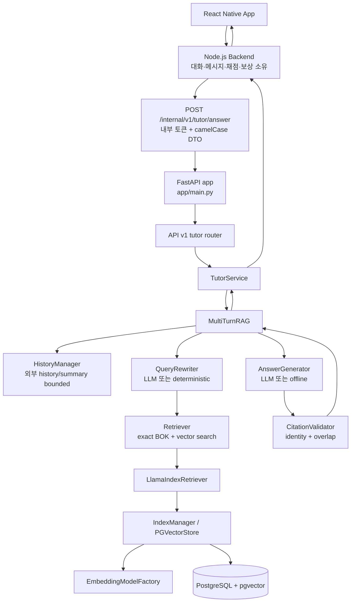
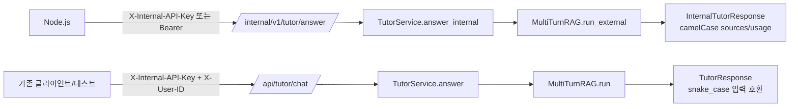

# Leren AI 아키텍처

## 실제 요청 흐름

현재 코드에서 운영 경계로 확인되는 흐름은 Node.js 백엔드가 대화 상태를 소유하고 FastAPI AI 서버에 내부 요청을 보내는 방식입니다. FastAPI는 전달받은 history/summary를 이용해 검색과 답변을 수행하고 `sources`, `usage`, `groundingStatus`를 돌려줍니다.

## 내부 API와 레거시 API

`/internal/v1/tutor/answer`는 Node.js가 `conversationId`, history, summary를 보냅니다. FastAPI는 이 경로에서 conversation/message/request 테이블을 생성하거나 수정하지 않습니다. `/api/tutor/chat`은 기존 프로세스 내 대화 repository를 사용하는 호환 경로입니다.

## 데이터 소유권

| 데이터 | 현재 소유/저장 | 확인 근거 |
|---|---|---|
| 대화·메시지·요청 | Node.js 백엔드 | `TutorService.answer_internal`, ERD 문서, 내부 API 계약 |
| AI 사용자 memory | FastAPI가 연결할 수 있는 `ai_user_memories` | `MemoryRepository`, `db.connection.create_tables` |
| RAG 문서/청크 메타데이터 | FastAPI | `RAGDocumentRepository`, `RAGDocument/RAGChunk` |
| 벡터 index | LlamaIndex `PGVectorStore` + PostgreSQL | `VectorStoreFactory`, `IndexManager` |
| 원본 파일/객체 저장 | 확인되지 않음 | S3 SDK, bucket 환경변수, upload 코드 없음 |

`app/db/models.py`에는 Node.js 소유 테이블도 레거시 호환 목적으로 매핑되어 있지만, `create_tables()`는 FastAPI가 소유하는 memory/RAG 테이블만 생성합니다.

## 설정과 provider

`app/core/config.py`의 `Settings`가 `.env`와 환경변수를 읽습니다. `app/api/dependencies.py`가 한 요청에 사용할 provider와 RAG 구성요소를 조립합니다.

- LLM: `LLM_PROVIDER=openrouter|openai|offline|none`
- Embedding: `EMBEDDING_PROVIDER=openrouter|openai|deterministic`
- OpenRouter 모델은 provider-qualified ID를 요구합니다.
- `DATABASE_URL`은 호스트 실행 시 `localhost:5433`, Compose AI 컨테이너에서는 `db:5432`입니다.
- 내부 API는 `INTERNAL_API_TOKEN`과 header 검증을 사용합니다.

## 확인되지 않은 영역

- React Native와 Node.js의 실제 저장소는 현재 Python 저장소에 포함되어 있지 않아 호출 코드 자체는 확인하지 못했습니다. Python 쪽 내부 DTO와 계약 문서만 확인했습니다.
- AWS S3 연동 코드는 발견되지 않았습니다.
- 실제 OpenRouter/OpenAI latency, 비용, 모델 품질은 API key와 승인 corpus가 없어 이 저장소 테스트로 검증하지 않았습니다.
