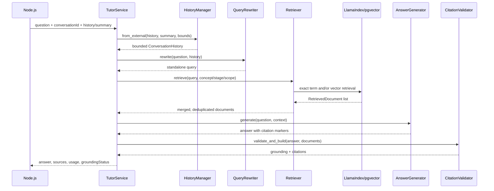

# Multi-turn RAG 파이프라인

## 처리 순서

## 1. 입력과 대화 기억

내부 요청은 `InternalTutorRequest`로 검증됩니다. `conversationId`, `userId`, `requestId`는 Node.js가 생성한 UUID이고, `history`는 sequence가 증가하는 `USER`/`ASSISTANT` 항목입니다. summary가 있으면 `summaryUntilSeq`와 함께 전달해야 합니다.

`HistoryManager.from_external()`은 다음을 적용합니다.

- summary 이전 sequence를 제외해 같은 내용을 중복 전송하지 않음
- 최대 message 수와 추정 token 수로 context를 제한
- summary를 별도 `summary` message로 앞에 추가
- 현재 요청을 저장하지 않음

레거시 `/api/tutor/chat`에서는 `InMemoryConversationRepository`를 통해 생성한 conversation에 생성 성공 후 user/assistant turn을 함께 저장합니다. 내부 Node.js 경로에서는 이 저장을 수행하지 않습니다.

## 2. Query rewriting

`app/rag/retrieval/query_rewriter.py`의 `QueryRewriter`는 모든 질문을 무조건 바꾸지 않습니다. `그게`, `그럼`, `어떤 영향` 같은 후속 질문 marker와 이전 대화가 있을 때만 rewrite를 시도합니다.

- LLM이 있으면 짧은 독립 질문 prompt를 호출
- LLM 호출 실패/timeout이면 deterministic하게 이전 user question의 주제와 현재 질문을 결합
- rewrite가 필요하지 않으면 원문을 그대로 사용

## 3. Ingestion과 indexing

입력은 자동 네트워크 수집이 아니라 검토된 로컬 파일입니다.

1. `rag/ingestion/document_loader.py`가 `.md`/`.txt`를 읽고 공백을 보수적으로 정리합니다.
2. `rag/ingestion/bok_terms_loader.py`가 BOK source JSON과 RAG JSONL의 ID/필드/hash/검토 상태를 비교합니다.
3. `rag/indexing/indexer.py`가 승인 문서만 `IngestDocument`로 정규화합니다.
4. 본문 SHA-256 및 repository hash로 중복 입력을 건너뜁니다.
5. LlamaIndex `SentenceSplitter`로 chunk를 생성하고 안정적인 `document_id:content_hash:index` chunk ID를 부여합니다.
6. `IndexManager`가 `EmbeddingModelFactory`와 `VectorStoreFactory`로 LlamaIndex `VectorStoreIndex`/`PGVectorStore`를 구성합니다.
7. vector insert 성공 뒤 `RAGDocumentRepository`가 문서/청크 메타데이터를 저장합니다.

기존 collection의 embedding provider/model/dimension이 설정과 다르면 `IndexConfigurationError`를 발생시켜 조용한 index 오염을 막습니다.

## 4. Retrieval

`Retriever`는 backend인 `LlamaIndexRetriever`에 다음 정책을 적용합니다.

- 승인 문서만 검색
- concept/stage/knowledge scope 조건을 전달
- BOK 용어 catalog가 있으면 exact 결과를 vector 결과와 citation key로 병합
- 관련 용어를 설정된 수만큼 추가 검색
- 중복 문서를 제거하고 top-k로 제한

LlamaIndex adapter는 `PGVectorStore` 검색 결과의 metadata를 `RetrievedDocument`로 변환합니다. DB 연결 또는 index 설정 오류는 `RetrievalError`로 감쌉니다.

## 5. Context와 generation

`ContextBuilder`는 현재 질문, rewrite 결과, 제한된 history, 검색 문서, learning concept/stage/concept를 하나의 prompt context로 만듭니다. `AnswerGenerator`는 provider LLM을 호출하고 usage/timeout을 기록합니다.

문서가 하나도 없으면 LLM이 추측하지 않고 자료 부족 응답을 반환합니다. `LLM_PROVIDER=offline|none`이면 검색된 첫 문서를 이용하는 테스트용 offline 답변 경로가 사용될 수 있습니다.

## 6. Citation과 grounding

LLM 답변의 `[출처: document_id/chunk_id]` 또는 `[source: ...]` marker를 검색 결과와 대조합니다.

- 검색 결과에 없는 문서/청크를 인용하면 citation을 폐기하고 unsupported marker를 제거
- 승인 상태가 아닌 문서의 인용은 유효하지 않음
- citation이 실제 답변과 근거 문서의 token overlap 기준을 넘는지 확인
- 이 검사는 citation identity와 간단한 lexical overlap만 보장하며, 사실성·출처 원문 검증을 대체하지 않음

최종 응답은 내부 API에서 `groundingStatus`, `sources`, `usage`로 반환됩니다. citation이 유효하지 않으면 `sources=[]`, `grounded=false`가 될 수 있습니다.

## 7. 문제 생성 준비 로직

`app/question_generation/generator.py`는 현재 완성된 문제 생성/검증기가 아닙니다. 기존 blueprint가 있고 승인된 evidence에 `document_id`와 content가 있을 때만 근거 기반 prompt를 만들어 `DRAFT_READY`를 반환합니다.

- blueprint가 없으면 `BLOCKED_NEEDS_AUTHORING`
- 승인 근거가 없으면 `BLOCKED_NO_APPROVED_EVIDENCE`
- LLM 호출, 최종 승인, 중복 문제 검사, 사용자 채점/보상은 아직 이 모듈의 책임이 아님
