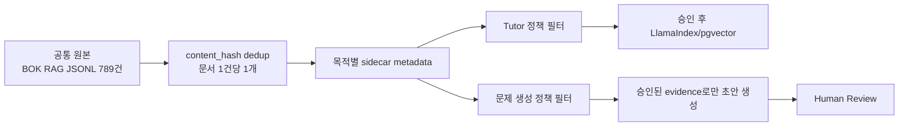

# Leren AI STEP 2 데이터 활용 정책 및 챕터·개념 매핑 설계

## 1. 작업 범위와 원칙

이번 단계는 STEP 1 결과를 바탕으로 다음을 설계한 작업이다.

- BOK 경제·금융 용어 789건의 Tutor/문제 생성 활용 정책
- 공통 원본과 목적별 메타데이터를 분리하는 저장 구조
- chapter/concept/stage 식별자 확인 및 매핑 규칙
- 인플레이션 파일럿 후보 매핑과 사람 검수 큐
- `approved`, `needs_review`, `irrelevant` 기준
- Keyword-only, LLM-only, Hybrid 분류 실험 및 평가 기준

다음 작업은 하지 않았다.

- 원본 JSON/JSONL 수정
- PostgreSQL/pgvector 쓰기 또는 embedding 생성
- 기존 RAG, FastAPI, API 계약 수정
- 외부 LLM API 호출
- 실제 문제 생성 또는 최종 매핑 승인

### 결과 표기 규칙

- **확인된 사실**: 현재 로컬 코드·데이터에서 직접 확인한 내용
- **설계 제안**: 다음 구현 단계에서 사용할 정책·스키마
- **미검증/차단**: 필요한 외부 파일·DB·권한이 없어 확정할 수 없는 내용

## 2. STEP 1 데이터와 코드 확인 결과

### 확인된 데이터

| 항목 | 결과 | 근거 |
|---|---:|---|
| BOK RAG 원본 레코드 | 789건 | `data/bok_terms_2026_rag.jsonl` |
| 기존 source review status | approved 760건, needs_review 29건 | JSONL 및 STEP 1 리포트 |
| 문서 중복 | document ID 0건, content hash 0건 | STEP 1 품질 검사 |
| 챕터·개념 필드 | `concept_id`, `concept_code`, `stage_id` 모두 789건 누락 | `reports/metadata_field_report.csv` |
| license 값 | 모든 BOK RAG 레코드에 존재하지만 `permission-and-attribution-review-required` | JSONL/추출 리포트 |
| 원본 PDF | 로컬 파일 없음 | STEP 1 파일 탐색 결과 |
| 멘토 C0704 데이터 | `terms_approved.jsonl`, `terms_needs_review.jsonl` 없음 | `outputs/c0704/evaluation_status.json` |

### 기존 식별자와 스키마

현재 코드에는 다음 식별자 사용 흔적이 있다.

| 식별자 | 확인 위치 | 해석 상태 |
|---|---|---|
| `C0704` | `app/question_generation/dataset.py`, `scripts/select_concept_documents.py`, 테스트 | 코드·테스트의 인플레이션 후보용 참조값. 실제 canonical curriculum에서 검증되지 않음 |
| `R07_S04` | 테스트 fixture의 `stage_id` | fixture 예시 및 멘토 데이터 기대값. 운영 curriculum 파일이 없어 실제 값으로 확정 불가 |
| `concept_id` | `IngestDocument`, Tutor schema, repository, retriever | 데이터 필드는 준비되어 있으나 BOK 789건에는 값 없음 |
| `concept_code` | Tutor schema, question generation, selection code | 입력·필터 인터페이스는 있으나 canonical mapping 데이터 없음 |
| `stage_id` | Tutor schema, memory, question generation, repository | 입력·저장 인터페이스는 있으나 canonical mapping 데이터 없음 |

`app/question_generation/dataset.py`에는 `validate_curriculum()`이 있고 `regions`, `stages`, `concepts`, `edges`, `question_blueprint` 구조를 기대한다. 그러나 이 저장소에는 검증할 실제 curriculum JSON이 없다. 따라서 이 문서의 파일럿에는 `chapter_id`, `concept_id`, `concept_code`, `stage_id`를 임의로 채우지 않았다.

## 3. 공통 원본과 목적별 활용 정책

### 제안하는 물리 구조

데이터를 Tutor용과 문제 생성용으로 복사하지 않고, 공통 원본 한 개와 목적별 sidecar 매핑을 사용한다.



제안 key는 `source_id + document_id + content_hash`다. 동일 본문을 목적별 JSONL로 중복 저장하지 않고, 매핑 sidecar에서 `usage_type`, chapter/concept/stage, 검수·라이선스 상태를 관리한다. embedding도 고유 `content_hash`마다 한 번만 생성하고 소비자별 필터를 적용한다.

### Tutor 검색 정책

현재 BOK 760건은 검색 후보일 뿐 운영 승인 자료가 아니다.

운영 검색 허용 조건:

```text
source_review_status == approved
AND mapping_review_status in {approved, not_applicable_for_global_tutor}
AND license_status == approved
AND usage_type in {both_candidate, tutor_candidate}
```

검색 시에는 `review_status=approved`를 기본 필터로 유지하고, canonical curriculum이 공급되면 `concept_id`, `concept_code`, `stage_id`를 추가 필터로 사용한다. 답변에는 `document_id`, `chunk_id`, `source_url`, `printed_page`, `content_hash`를 출처로 남긴다.

### 문제 생성 정책

문제 생성은 더 강한 조건을 요구한다.

```text
source_review_status == approved
AND mapping_review_status == approved
AND license_status == approved
AND usage_type in {both_candidate, question_candidate}
AND concept_id/concept_code/stage_id are canonical values
AND learning_goal and question blueprint are present
```

문제 생성용 evidence에는 최소한 `evidence_document_id`, `evidence_quote`, `source_url`, `printed_page`, `content_hash`를 연결한다. 생성 결과는 draft로만 만들고, 정답·해설·중복·출처·교육목표를 사람 검수 후 게시한다. 현재 코드의 `prepare_question_generation()`도 승인 evidence와 blueprint가 없으면 생성 준비를 차단하는 방향이다.

### 현재 BOK 데이터의 정책 상태

현재 789건은 license 상태가 모두 권한·출처 검토 대기이므로, 본 작업 결과만으로 Tutor 운영 색인 또는 문제 생성 운영 승인을 내리지 않는다. source `approved`는 기존 ingestion/index eligibility일 뿐 전문가 검수·라이선스 승인·교육적 적합성 승인이 아니다.

## 4. 제안 메타데이터 스키마

기계 판독 가능한 상세안은 [`metadata_schema.json`](metadata_schema.json)에 있다.

### 공통 원본 필드

| 필드 | 타입/상태 | 역할 |
|---|---|---|
| `document_id` | string, required | 원본 문서의 안정적 식별자. BOK에서는 현재 789개 고유 |
| `source_id` | string, required | 출처 컬렉션 식별자. BOK에서는 동일 값이 반복됨 |
| `content_hash` | string, required | SHA-256 본문 hash. 중복 방지·split 누수 방지 key |
| `document_version` | string, required | 원본 버전 스냅샷 |
| `source_url` | string, required when known | 외부 출처 추적 |
| `title`, `term`, `content`, `definition` | string | 검색·근거·문제 생성의 원문 |
| `publisher`, `source_type`, `printed_page` | string/string/int nullable | 출처와 원문 위치 |

### 목적·매핑 sidecar 필드

| 필드 | 제안 값 | 설명 |
|---|---|---|
| `chapter_label` | nullable string | 사람이 읽는 라벨. canonical ID와 혼동하지 않음 |
| `concept_id` | nullable string | canonical curriculum에서만 입력 |
| `concept_code` | nullable string | canonical curriculum에서만 입력 |
| `stage_id` | nullable string | canonical curriculum에서만 입력 |
| `usage_type` | `both_candidate`, `tutor_candidate`, `question_candidate`, `review_only`, `excluded` | 소비 목적 후보 |
| `mapping_method` | `manual`, `keyword`, `llm`, `hybrid` | 매핑 산출 방식 |
| `mapping_status` | `PENDING_HUMAN_REVIEW`, `APPROVED`, `NEEDS_REVIEW`, `IRRELEVANT` | 목적·챕터 단위 검수 상태 |
| `evidence_sentence` | nullable string | 판단 근거가 되는 원문 문장 |
| `source_review_status` | `approved`, `needs_review` | 기존 ingestion 상태와 분리하지 않고 보존 |
| `mapping_review_status` | `approved`, `needs_review`, `irrelevant` | 새로 제안하는 목적별 사람 검수 상태 |
| `license_status` | `approved`, `pending_review`, `unknown`, `rejected` | 사용 권한 승인 상태 |
| `reviewer`, `reviewed_at`, `review_note` | nullable | 감사 추적 및 이견 기록 |

### 상태 의미

- `approved`: 해당 파일럿 chapter/concept에 실제로 관련되고, evidence가 충분하며 사람이 확인함
- `needs_review`: 키워드나 모델 판단은 있으나 범위·근거·출처·식별자가 불명확함
- `irrelevant`: 해당 chapter/concept에는 관련 없음. 공통 원본에서 삭제하지 않고 해당 sidecar 매핑만 제외함
- `license_status=approved`가 아니면 아무리 source review가 approved여도 운영 사용을 허용하지 않음

## 5. 인플레이션 파일럿 매핑

### 파일럿 식별자

파일럿 이름은 **인플레이션**으로 정했다. 이는 설계용 label이며 canonical chapter/concept가 아니다.

```json
{
  "pilot_chapter_label": "인플레이션",
  "chapter_id": null,
  "concept_id": null,
  "concept_code": null,
  "stage_id": null,
  "status": "DESIGN_LABEL_ONLY"
}
```

`C0704`와 `R07_S04`는 기존 코드·테스트에 등장하므로 참고로 기록할 수 있지만, 실제 curriculum 파일이 없는 현재 상태에서 이 파일럿의 canonical 값으로 사용하지 않는다.

### 후보 산출 결과

기존 `select_c0704_candidates()` 및 `KeywordRelevanceClassifier`를 외부 호출 없이 BOK RAG 789건에 적용해 후보를 만들었다.

| 항목 | 건수 | 해석 |
|---|---:|---|
| 전체 BOK RAG | 789 | 후보 생성의 전체 모수 |
| keyword baseline 후보 | 55 | 자동 후보일 뿐 최종 매핑 아님 |
| baseline `DIRECT` | 41 | 직접 관련으로 표시됐으나 incidental mention 포함 가능 |
| baseline `INDIRECT` | 13 | 물가·가격 표현 기반 간접 후보 |
| baseline `EXCLUDE` | 1 | `인플레이션감축법(IRA)` 오탐 후보 |
| 제안 `core` | 9 | 인플레이션 및 대표 변형/원인 |
| 제안 `related` | 18 | 측정·정책·파급 관련 |
| 제안 `context` | 11 | 맥락 후보, 사람 확인 필요 |
| 제안 `review` | 16 | keyword baseline과 의미 범위가 충돌하거나 약함 |
| 제안 `exclude` | 1 | 인플레이션감축법(IRA) |

대표 후보와 근거:

| 분류 | 용어 | document_id | 근거 문장 요약 |
|---|---|---|---|
| core | 인플레이션 | `bok800-504` | 물가수준이 지속적으로 상승하는 현상 |
| core | 디스인플레이션 | `bok800-209` | 물가수준은 높아지지만 물가상승률은 둔화되는 현상 |
| core | 디플레이션 | `bok800-211` | 물가가 지속적으로 하락하는 현상이며 인플레이션과 반대 방향 |
| core | 스태그플레이션 | `bok800-373` | 경기 침체·실업 증가와 인플레이션이 동시에 지속되는 현상 |
| core | 근원인플레이션율 | `bok800-108` | 일시적 공급충격을 제외한 기조적 물가상승률 |
| core | 비용인상 인플레이션 | `bok800-298` | 노동·자본·원자재 등 투입요소 비용 상승이 물가를 올리는 현상 |
| core | 수요견인 인플레이션 | `bok800-353` | 초과수요로 재화·서비스 물가가 지속 상승하는 현상 |
| related | 소비자물가지수(CPI) | `bok800-347` | 가계가 구입하는 상품·서비스 가격 변동을 종합하는 지표 |
| related | 물가안정목표제 | `bok800-242` | 중앙은행이 물가상승률 목표를 제시하고 통화정책을 운영하는 방식 |
| related | 기대인플레이션 | `bok800-143` | 향후 물가상승률에 대한 경제주체의 전망 |
| related | 통화정책 파급경로 | `bok800-684` | 금리·자산가격·환율·기대·신용 등 정책 전파 경로 |
| exclude | 인플레이션감축법(IRA) | `bok800-505` | 용어명이 인플레이션을 포함하지만 미국 법률 설명으로 개념 챕터의 직접 근거가 아님 |

전체 55건의 문서 ID, hash, source URL, printed page, keyword 결과, 근거 문장은 [`inflation_mapping_candidates.csv`](inflation_mapping_candidates.csv)에 있다. 자동 결과의 `mapping_status`와 `gold_label`은 모두 사람 검수 대기 상태다.

### 실제 실행한 Keyword-only 1차 실험

전체 789건에 기존 `keyword-v1` 규칙을 실행했다. 결과는 [`keyword_evaluation.json`](keyword_evaluation.json), 전체 예측은 [`inflation_keyword_predictions.csv`](inflation_keyword_predictions.csv)에 저장했다.

| 항목 | 결과 |
|---|---:|
| 전체 예측 문서 | 789 |
| keyword 매칭 후보 | 55 |
| `DIRECT` | 41 |
| `INDIRECT` | 13 |
| 명시적 오탐 후보 `EXCLUDE` | 1 |
| keyword 미매칭 문서 | 734 |
| Gold Label 입력 | 0/789 |
| Precision/Recall/F1 | `NOT_EVALUATED` |

자동 예측을 Gold Label로 복사하지 않았다. 전체 평가용 입력 템플릿은 [`inflation_gold_label_template.csv`](inflation_gold_label_template.csv)이며, 사람이 `approved`, `needs_review`, `irrelevant`를 입력한 뒤 같은 실험을 재실행해야 metric이 계산된다.

## 6. 사람 검수 시트 및 Gold Label 지침

검수 시트는 [`inflation_review_sheet.csv`](inflation_review_sheet.csv)다. 각 행은 하나의 `document_id`이며, 목적별 매핑이므로 같은 문서가 다른 chapter sidecar에 별도 행으로 존재할 수 있다. 원문 자체를 복사하지 않고 필요한 근거 문장만 짧게 기록한다.

### 검수 절차

1. reviewer가 `source_url`, `printed_page`, `content_hash`로 원문 provenance를 확인한다.
2. 파일럿 chapter의 learning goal과 evidence 문장이 실제로 연결되는지 확인한다.
3. `approved`, `needs_review`, `irrelevant` 중 하나를 선택한다.
4. `approved` 또는 `irrelevant`에는 한 문장 이상의 근거를 `review_note`에 기록한다.
5. reviewer, reviewed_at, mapping method, 이견 여부를 채운다.
6. 두 명의 판단이 다르면 adjudicator가 최종 결정을 기록한다.

### Label 지침

| Gold label | 부여 조건 | 운영 처리 |
|---|---|---|
| `approved` | 인플레이션 chapter의 학습목표를 직접 설명하거나, 정의·측정·원인·정책·전파 중 하나를 충분한 evidence로 설명 | license가 승인된 경우에만 목적별 후보로 사용 |
| `needs_review` | 키워드는 있으나 문서의 주제가 다른 분야이거나, chapter 범위·근거·원문 출처를 추가 확인해야 함 | Tutor/문제 생성에서 제외하고 review queue 유지 |
| `irrelevant` | 법률명·사례·부수적 표현 등으로 키워드만 일치하고 학습목표를 설명하지 않음 | 해당 파일럿 매핑에서 제외. 공통 원본은 유지 |

`source_review_status=needs_review`인 29건은 chapter gold label을 `approved`로 확정할 수 없다. 현재 BOK 전체 license가 `pending_permission_attribution_review`이므로, 실제 gold label과 별개로 운영 허용 flag는 false다.

### Gold set 구성 권장

- 전체 파일럿 후보 55건을 먼저 라벨링한다.
- `core`, `related`, `context`, IRA 오탐, source `needs_review`를 모두 포함한다.
- keyword baseline이 `DIRECT`라고 해도 gold positive로 간주하지 않는다.
- `content_hash`가 같은 행은 train/dev/test에 나누지 않는다.
- 불일치 행은 두 reviewer가 근거 문장을 함께 확인하고 adjudication 기록을 남긴다.

## 7. Keyword-only / LLM-only / Hybrid 실험 설계

상세 JSON은 [`classification_experiment_design.json`](classification_experiment_design.json)에 있다.

### 공통 입력

- canonical source row 1건
- `document_id`, `source_id`, `content_hash`, `title`, `term`, `definition`, `content`, `source_url`
- 파일럿 chapter label과 추후 공급될 canonical learning goal
- 버전이 고정된 keyword, alias, exclusion 목록

### Keyword-only

현재 코드의 `select_c0704_candidates()`가 baseline이다. 출력은 `classification_label`, score, matched keywords, rule version, evidence sentence로 한다.

현재 baseline의 한계는 `DIRECT` 판정이 정의의 핵심 여부보다 본문 내 표현 존재에 크게 의존한다는 점이다. 예를 들어 `고정금리부채권`, `비트코인`, `인플레이션감축법` 같은 incidental mention이 후보에 포함된다. 따라서 keyword 결과는 recall을 높이는 후보 생성기로만 사용한다.

### LLM-only

입력 문서와 chapter learning goal을 주고 다음 JSON만 반환하도록 설계한다.

```json
{
  "document_id": "bok800-504",
  "label": "approved",
  "confidence": 0.0,
  "rationale": "짧은 판단 근거",
  "evidence_quote": "원문에 실제 존재하는 짧은 문장",
  "model_version": "required"
}
```

`evidence_quote`가 원문에 포함되지 않으면 무효 응답으로 처리하고, confidence만으로 승인하지 않는다. 이번 STEP 2에서는 LLM client를 제공하지 않았으며 호출하지 않았다.

### Hybrid

권장 순서는 다음과 같다.

1. 정확한 핵심 용어와 명시적 제외 규칙으로 high-precision 후보를 만든다.
2. `context`, 낮은 점수 `DIRECT`, keyword 충돌 후보만 LLM 검토 대상으로 보낸다.
3. 모델의 evidence와 confidence를 schema 검증한다.
4. 사람 reviewer가 최종 `approved/needs_review/irrelevant`를 확정한다.
5. 최종 승인 전까지 원본과 운영 인덱스에는 쓰지 않는다.

### 평가 지표

사람 Gold label이 없으면 `NOT_EVALUATED`다. 자동 후보를 정답으로 사용하지 않는다.

`approved`를 positive로 정의할 때:

```text
precision = TP / (TP + FP)
recall    = TP / (TP + FN)
F1        = 2 * precision * recall / (precision + recall)
```

추가로 coverage, abstention rate, false positive rate, evidence span accuracy를 보고한다. train/dev/test는 source와 content hash 기준으로 누수를 방지하고, threshold는 dev에서 선택한 뒤 test에서 최종 평가한다.

## 8. 다음 단계 작업 목록

1. **Canonical curriculum 확보**: 실제 `concept_id`, `concept_code`, `stage_id`, chapter label, learning goal, question blueprint 파일을 받는다.
2. **식별자 검증**: `C0704`, `R07_S04`가 실제 운영 값인지 curriculum validator로 확인한다.
3. **라이선스 확인**: 한국은행 데이터의 사용 권한과 attribution 문구를 확인하고 `license_status`를 갱신한다.
4. **Gold label 작성**: 파일럿 55건을 최소 2인이 검토하고 adjudication한다.
5. **Keyword 개선**: exact term, alias, exclusion, context rule을 버전 관리한다.
6. **분류 실험**: keyword-only를 먼저 측정하고, 필요 시 LLM-only/hybrid를 동일 Gold set에 적용한다.
7. **sidecar 구현**: 원본 중복 없이 매핑·usage·review·license 정보를 별도 저장한다.
8. **Tutor 인덱싱 검증**: license 승인 후 approved 자료만 별도 검증 환경에 embedding하고 citation 회수율을 평가한다.
9. **문제 생성 검증**: blueprint와 evidence가 있는 승인 매핑만 draft 생성에 사용하고, 최종 게시·채점 책임은 기존 Node.js 구조에 유지한다.

## 9. 산출물 및 실행 검증

| 파일 | 설명 |
|---|---|
| [`step2_summary.json`](step2_summary.json) | 후보 수, 상태 수, 식별자 미확정, 실행 제한 요약 |
| [`data_usage_policy.json`](data_usage_policy.json) | 공통 원본·sidecar·사용 승인 정책 |
| [`metadata_schema.json`](metadata_schema.json) | 제안 메타데이터 필드와 상태 enum |
| [`inflation_mapping_candidates.csv`](inflation_mapping_candidates.csv) | BOK 789건에서 나온 55건 후보와 근거 문장 |
| [`inflation_review_sheet.csv`](inflation_review_sheet.csv) | reviewer 입력용 검수 큐 |
| [`inflation_keyword_predictions.csv`](inflation_keyword_predictions.csv) | BOK 789건 전체에 대한 Keyword-only 예측 |
| [`inflation_gold_label_template.csv`](inflation_gold_label_template.csv) | 789건 전체 Gold Label 입력 템플릿 |
| [`keyword_evaluation.json`](keyword_evaluation.json) | 현재 Keyword-only 평가 상태와 metric |
| [`classification_experiment_design.json`](classification_experiment_design.json) | 세 분류 방식의 입력·출력·평가 설계 |
| [`generate_step2_design_artifacts.py`](../../scripts/generate_step2_design_artifacts.py) | 원본/DB/API를 변경하지 않고 산출물을 재생성하는 스크립트 |
| [`evaluate_inflation_keyword.py`](../../scripts/evaluate_inflation_keyword.py) | Keyword-only 예측과 Gold Label 평가 스크립트 |

실행한 검증:

```bash
ruff check scripts/generate_step2_design_artifacts.py
./.venv/bin/python -m scripts.generate_step2_design_artifacts
./.venv/bin/python -m scripts.evaluate_inflation_keyword
./.venv/bin/python -m pytest -q
```

결과:

- STEP 2 산출물 생성 성공
- keyword 후보 55건 생성
- BOK 789건 Keyword-only 예측 생성
- Gold Label 0/789이므로 평가 상태는 `NOT_EVALUATED`
- 외부 LLM 호출 0회
- DB/pgvector 쓰기 0회
- 원본 데이터 변경 없음
- 기존 테스트 **49 passed**

단, 실제 curriculum 식별자, 라이선스 승인, PostgreSQL/pgvector live index, 외부 LLM 분류 성능은 미검증이다.
